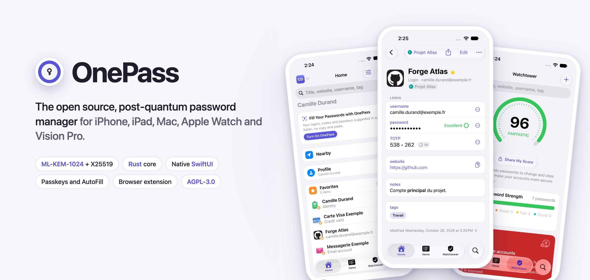
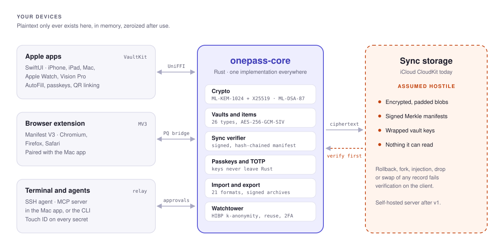
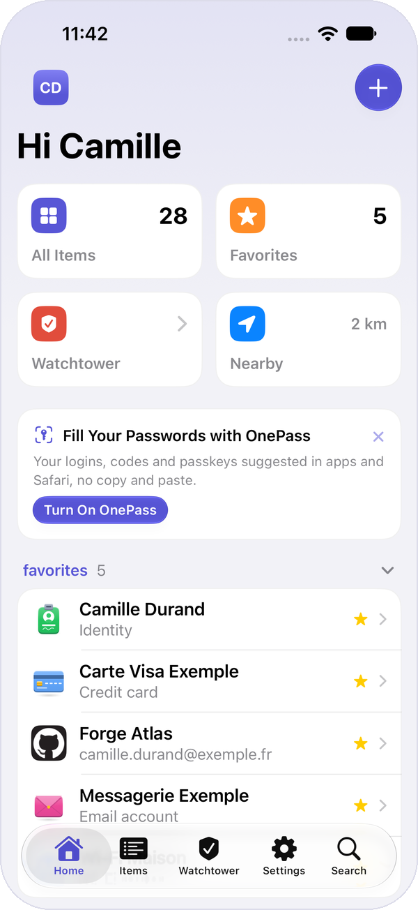
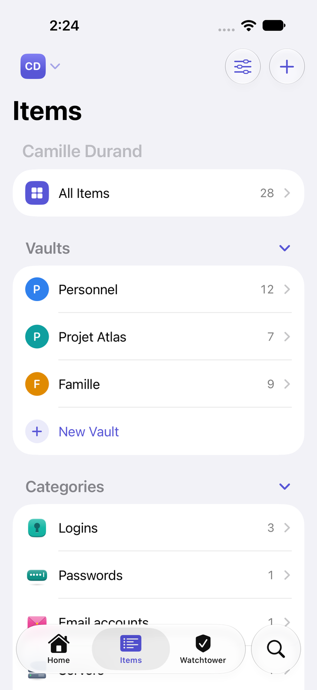
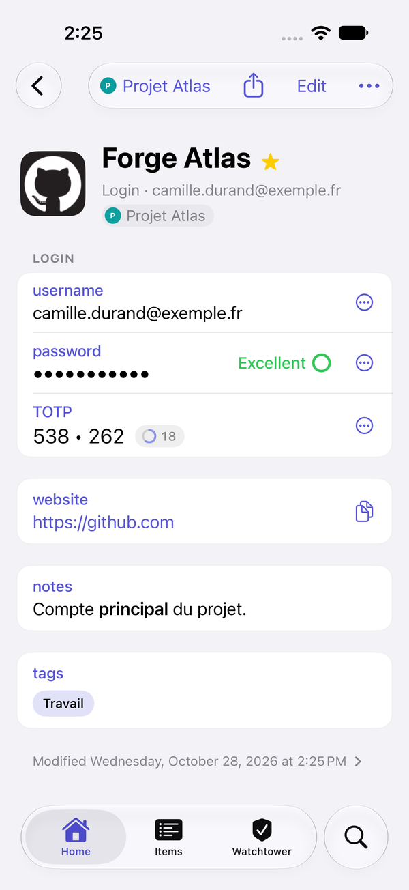
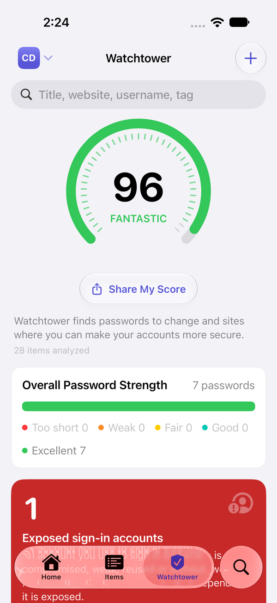
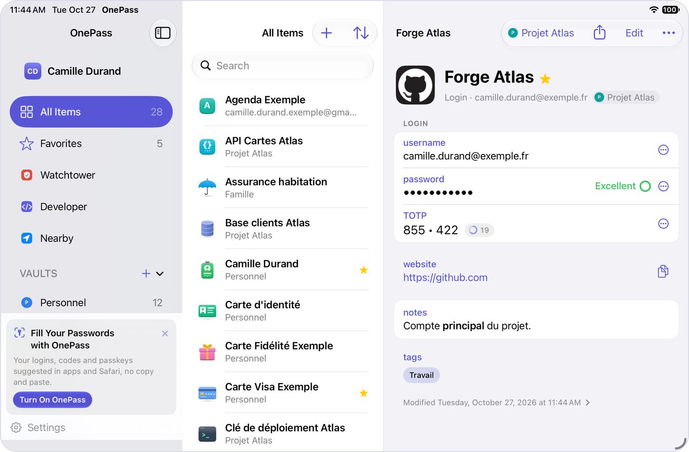
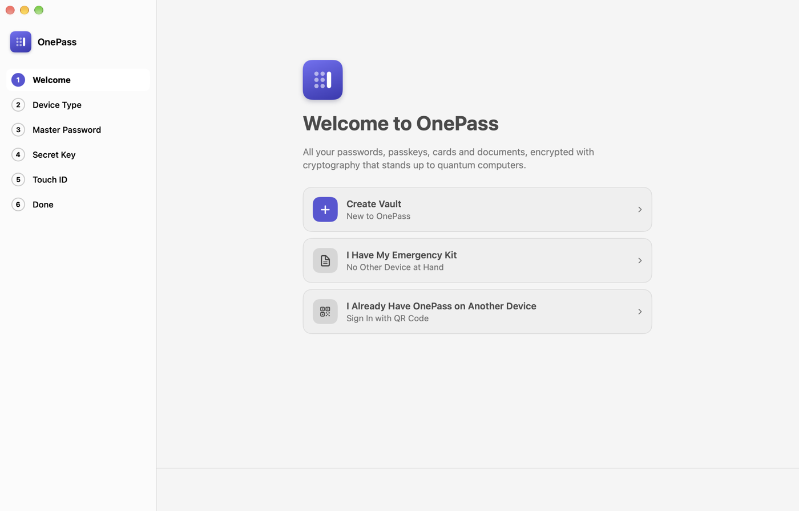
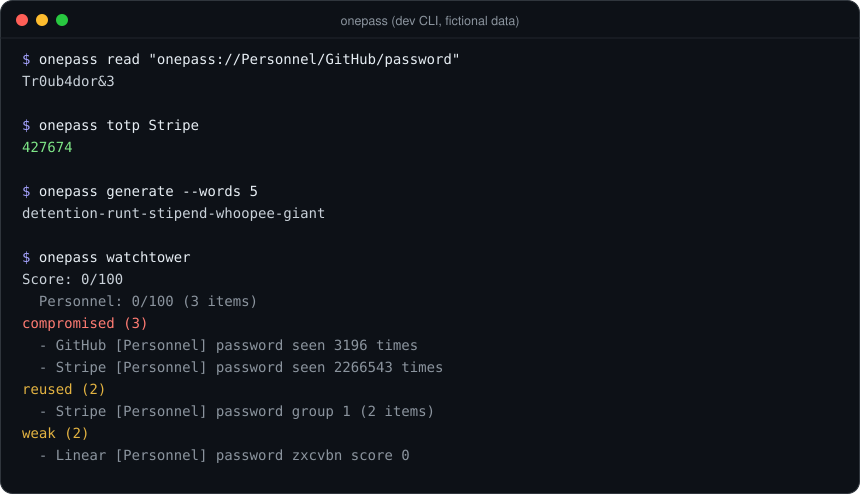
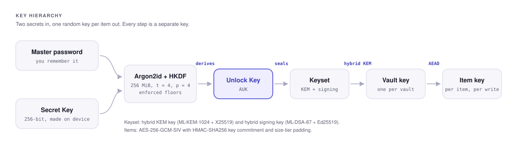

<div align="center">

<picture>
  <source media="(prefers-color-scheme: dark)" srcset="docs/assets/readme/hero-dark.png">
  
</picture>

<br>

[](https://github.com/soma-intelligence/onepass/actions/workflows/core.yml)
[](https://github.com/soma-intelligence/onepass/actions/workflows/extension.yml)
[](https://github.com/soma-intelligence/onepass/releases)
[](LICENSE)
<br>


**[Features](#features)** · **[Security](#security-model)** · **[Compare](#how-onepass-compares)** · **[Screenshots](#a-look-around)** · **[Install](#install)** · **[Build from source](#build-from-source)** · **[Roadmap](#roadmap)** · **[Contributing](#contributing)**

</div>

> [!WARNING]
> OnePass is **pre-release software (v0.2.x)**. It has not had an external security audit yet (planned for milestone 8). The dev CLI and the dev native messaging host keep secrets in a form meant for development only: the Mac app is the way to use OnePass day to day. Do not store real secrets in OnePass until the first audited release.

## Why OnePass

<table>
<tr>
<td width="33%" valign="top">

**Post-quantum from day one**<br>
Vault keys are wrapped with hybrid ML-KEM-1024 + X25519. Manifests and backups are signed with hybrid ML-DSA-87 + Ed25519. Your account identity is an SLH-DSA key. Data harvested today stays safe against tomorrow's quantum computers.

</td>
<td width="33%" valign="top">

**The server is the adversary**<br>
Every vault carries a signed, hash-chained manifest with a Merkle root. A broken or malicious sync backend cannot roll back, fork, inject, drop or swap items without the client noticing. Each attack class from the 2026 ETH Zurich / USI study of cloud password managers is a test here.

</td>
<td width="33%" valign="top">

**Two secrets, not one**<br>
Your key comes from your master password **and** a 256-bit Secret Key generated on your device. A stolen copy of the sync data is useless without both.

</td>
</tr>
<tr>
<td valign="top">

**Native everywhere**<br>
One SwiftUI app target for iOS, iPadOS, macOS (native, not Catalyst) and visionOS, plus a standalone Apple Watch app, widgets, Controls and Shortcuts. On iPhone: Home, Items and Watchtower tabs, with search one tap away.

</td>
<td valign="top">

**At home in a terminal**<br>
The Mac app serves an SSH agent with Touch ID on every signature, and an MCP server so AI agents can *use* a credential without ever *seeing* it. A CLI too.

</td>
<td valign="top">

**Reviewable and tested**<br>
Fuzzing, NIST ACVP vectors, differential tests between two crypto libraries, ProVerif models, and a seeded autofill lab that measures fill rate and leaks.

</td>
</tr>
</table>

## How it fits together

<picture>
  <source media="(prefers-color-scheme: dark)" srcset="docs/assets/readme/architecture-dark.svg">
  
</picture>

One Rust core holds every piece of crypto and vault logic, and the Apple apps reach it through UniFFI. On the Mac, the unlocked app is also the hub for everything outside it:

- **Browsers.** The app serves the extension bridge on a Unix socket in its App Group container. Safari's extension ships inside the app. Chrome and Firefox launch `onepass-relay`, a signed helper inside `OnePass.app`. Both ends check each other's code signature through the kernel audit token (`onepass-peer`), and the extension's traffic is end-to-end encrypted with a post-quantum key paired by a 6-digit code.
- **Terminals and AI agents.** The SSH agent and the MCP server run in the app. MCP clients launch the bundled `onepass-mcp` relay, which identifies its caller and forwards lines without reading them. Every secret needs your approval in a floating panel, with Touch ID, and lands in a signed, hash-chained audit log.
- **Other devices.** A new device joins by showing a QR code that an unlocked iPhone or iPad scans. Both screens show a 6-digit code before anything is sent, and the device list is signed.

Sync storage only ever sees padded ciphertext, and everything it returns is verified before use.

## A look around

<table>
<tr>
<td align="center" width="25%"><picture><source media="(prefers-color-scheme: dark)" srcset="docs/assets/readme/iphone-home-dark.png"></picture><br><sub>Home</sub></td>
<td align="center" width="25%"><picture><source media="(prefers-color-scheme: dark)" srcset="docs/assets/readme/iphone-items-dark.png"></picture><br><sub>Items</sub></td>
<td align="center" width="25%"><picture><source media="(prefers-color-scheme: dark)" srcset="docs/assets/readme/iphone-detail-dark.png"></picture><br><sub>Item with TOTP</sub></td>
<td align="center" width="25%"><picture><source media="(prefers-color-scheme: dark)" srcset="docs/assets/readme/iphone-watchtower-dark.png"></picture><br><sub>Watchtower</sub></td>
</tr>
</table>

<table>
<tr>
<td align="center" width="50%"><picture><source media="(prefers-color-scheme: dark)" srcset="docs/assets/readme/ipad-dark.png"></picture><br><sub>iPad, three columns</sub></td>
<td align="center" width="50%"><picture><source media="(prefers-color-scheme: dark)" srcset="docs/assets/readme/mac-dark.png"></picture><br><sub>Mac, native SwiftUI (not Catalyst)</sub></td>
</tr>
</table>

<p align="center"><sub>All data in these screenshots is fictional demo data.</sub></p>

## Features

<details open>
<summary><b>Vault and items</b></summary>

- 26 item types: logins, passwords, secure notes, credit cards, bank accounts, crypto wallets, identities, passports, driver licenses, SSH keys, API credentials, servers, databases, routers, software licenses, documents and more. Logins also hold passkeys and TOTP secrets. Crypto wallets show watch-only balances on iPhone and iPad, read from public addresses: the recovery phrase is never sent anywhere.
- Multiple vaults, fast search, favorites, TOTP codes, `onepass://vault/item/field` secret references.
- Password and passphrase generator (EFF word lists).
- Auto-lock, unlock with Face ID, Touch ID or Apple Watch on Mac. The master password is required again after a reboot or after 14 days.
- Home shows what matters now: Nearby items on a map, Favorites, Recents. Change your master password and delete empty vaults from Settings.
- Emergency Kit PDF with a QR code, generated on device.
- Personal and shared device modes.

</details>

<details>
<summary><b>Devices</b></summary>

- **Add a device from another one.** The new iPhone, iPad or Mac shows a QR code, renewed every 30 seconds. An unlocked iPhone or iPad scans it, both screens show the same 6-digit code, and you confirm with Face ID or your master password. Nothing leaves before both confirmations.
- **Signed device list** in Settings > Devices: rename, or remove a device. A removed device erases its data, Secret Key and biometric enrollment the next time it unlocks or syncs.
- **Public computer mode.** Lend a few items to a borrowed device for 15 to 60 minutes. The guest session lives in memory only, is read-only, and ends on expiry, from your phone, after 5 idle minutes or when the app leaves the screen.

</details>

<details>
<summary><b>Sync</b></summary>

- End-to-end encrypted sync over **CloudKit**, inside your private iCloud database. Apple's own encryption is a bonus, not a dependency: the threat model assumes it fails.
- Self-hosted server (Rust, Postgres + S3) planned after v1.

</details>

<details>
<summary><b>AutoFill and passkeys</b></summary>

- System AutoFill provider on iPhone, iPad and Mac: QuickType suggestions, one-time codes in verification fields, unlock right inside the AutoFill sheet.
- **Passkeys** created and used inside the Rust core. The private key never reaches Swift.
- Save new passwords and suggest strong ones (iOS 26.2+).

</details>

<details>
<summary><b>Browser extension</b></summary>

- Manifest V3, TypeScript, no framework, in the app's look, in French, English, Spanish and Italian.
- **Safari** extension built into the Mac app. **Chrome and Firefox** builds talk to the same app through its signed relay. One end-to-end encrypted, post-quantum channel. On the Mac that runs the app, the extension pairs on its own, with no code to type (real-browser check pending). "Unlock in OnePass" in the extension brings the app forward to unlock, even when it was closed.
- Inline menu under the focused field, keyboard included. **One-click sign-in** that walks multi-step logins and "Sign in with Google, Apple, Microsoft or GitHub" chains, remembers which provider account you use on each site, and stops as soon as a step leaves the allowed domains.
- Save and update prompts, never-save list, HTTPS origins only. Payment iframes from other sites are never filled.

</details>

<details>
<summary><b>Watchtower</b></summary>

- A score dial and one card per check: weak, reused and old passwords, sites that support 2FA or passkeys where you have not turned them on, breached sites, exposed accounts, and a funded crypto wallet whose recovery phrase is not protected by Travel Mode.
- Notifications for new findings, and per-item exclusions.
- Leaked password check through Have I Been Pwned **k-anonymity** (5-character hash prefix, padded responses). Offline modes available.

</details>

<details>
<summary><b>Import and export (21 formats)</b></summary>

| Source | Formats |
|---|---|
| 1Password | 1PUX, CSV |
| Bitwarden | JSON, CSV |
| Chrome, Safari, Firefox | CSV |
| LastPass | CSV |
| Dashlane | CSV, ZIP |
| Proton Pass | CSV |
| NordPass, Keeper, RoboForm | CSV |
| Enpass | JSON |
| KeePass 2 | XML |
| FIDO Credential Exchange | CXF |
| Other | `otpauth://` URIs, Wi-Fi QR codes, OnePass archive, OnePass CSV |

Export to a signed, encrypted `.onepass` archive (passphrase or account recipient). Plaintext CSV export exists but needs an explicit `--plaintext` flag.

</details>

<details>
<summary><b>Apple Watch, Vision Pro and widgets</b></summary>

- Standalone, read-only Watch app with TOTP rings, complications and Smart Stack. At most 50 items, and never login passwords, CVVs, PINs or notes.
- iOS widgets ("Codes", "Favorites"), Controls (generate, search, lock), App Intents and Shortcuts.
- visionOS layout from the same app target.

</details>

<details>
<summary><b>Developer tools</b></summary>

All in Settings > Developer on the Mac, and stopped as soon as the app locks (unless your iPhone unlocks it for agents, below).

- **MCP server**: AI clients launch `OnePass.app/Contents/Helpers/onepass-mcp` (a copyable `mcpServers` block is in the app). Scoped tools (`metadata`, `use`, `write`, `totp`, `reveal`), vaults exposed only if a signed policy lists them, per-client grants you can revoke. Commands run with secrets injected and masked in output. Every secret request asks you in a floating panel, with Touch ID.
- **Agent-ready MCP**: one command adds OnePass to an AI client, `OnePass.app/Contents/Helpers/onepass-mcp install --client claude-code|claude-desktop|codex|cursor` (`--dry-run` shows the diff, a backup is kept, only the `onepass` entry changes; Settings > Developer gives you the command to copy). Approve each request on the Mac panel or on your iPhone with Face ID, whichever answers first; the agent is told a 4-letter code to match on screen, and the audit log records where you approved. Away from a locked Mac, your iPhone can unlock it for agents only: the app's own screens stay locked, the window lasts 1 hour by default (15 minutes to 8 hours) and ends on sleep, lock or "Lock now" on the phone. Off by default, enrolled per Mac and iPhone pair.
- **SSH agent**: Ed25519, ECDSA P-256/384/521 and RSA 3072/4096 keys from your vaults, generated or imported in the app. Approval for every signature, or for 5, 15 or 60 minutes. Agent forwarding refused by default.
- **Audit log**: hash-chained and signed, readable in the app.
- **Travel Mode** (Mac and iOS): mark vaults "Safe for Travel", and the others leave the device before you cross a border without being deleted from iCloud. Back home, they come back and are checked against the last manifests seen. Away from home, the app suggests turning it on, and single items can be marked safe for travel.
- **`onepass` CLI** with `onepass mcp` and `onepass ssh-agent` for development and Linux.

</details>

<p align="center">
  
</p>

## Security model

The full whitepaper and threat model live in [`docs/security/README.md`](docs/security/README.md). The short version:

<picture>
  <source media="(prefers-color-scheme: dark)" srcset="docs/assets/readme/keys-dark.svg">
  
</picture>

```
argon2_out = Argon2id(password_nfc, salt, m = 256 MiB, t = 4, p = 4)
AUK        = HKDF-SHA256(salt, argon2_out || secret_key, "onepass/auk/v1")
```
The Argon2id parameters above are enforced floors. The Secret Key is 256 bits, shown as 53 base32 characters with a Luhn mod 32 check character.

### Primitives

| Purpose | Algorithm |
|---|---|
| Password hashing | Argon2id v1.3 |
| Key derivation | HKDF-SHA256 |
| Blob encryption | AES-256-GCM-SIV + HMAC-SHA256 key commitment, size-tier padding |
| Vault key wrapping | ML-KEM-1024 + X25519 hybrid KEM |
| Manifests, backups, MCP policy | ML-DSA-87 + Ed25519 hybrid signature (both must verify) |
| Account root identity | SLH-DSA-SHA2-256s (FIPS 205) |
| Biometric unlock | Secure Enclave P-256 key, ECIES (X9.63, SHA-256, AES-GCM) |
| Passkeys | ECDSA P-256 (ES256) |
| Extension channel | ML-KEM-1024 + X25519, AES-256-GCM per direction, SAS pairing |

Crypto comes from `aws-lc-rs`, `argon2` and `slh-dsa` in Rust, and from WebCrypto plus `@noble/post-quantum` and `@noble/curves` in the extension.

### Threat model in brief
- **In scope:** a malicious or compromised storage backend (CloudKit, a future server, the network, a stolen disk) that modifies, replays, deletes, reorders or injects records. Hostile web pages and compromised renderers. Untrusted AI agents talking to the MCP server.
- **Out of scope:** a device compromised at OS level (root, jailbreak). An attacker who reads process memory (secrets are zeroized, `mlock` is not implemented yet). Traffic analysis beyond size-tier padding.
- **Known gaps** are listed honestly in the security doc and in the design specs.

### How it is tested

| | |
|---|---|
| **Known answers** | NIST ACVP vectors for ML-KEM-1024, ML-DSA-87 and SLH-DSA |
| **Differential** | `aws-lc-rs` against `libcrux`, property tests on the AEAD |
| **Fuzzing** | 19 `cargo-fuzz` targets, run in CI on every push |
| **Hostile server** | a malicious store test suite that replays every known server-side attack |
| **Formal models** | ProVerif (`formal/`) for account creation and unlock, vault manifests, the Emergency Kit and the extension bridge, including runs where one half of each hybrid KEM is broken. `make formal`, [results](docs/security/formal/results.md) |
| **Autofill lab** | hundreds of seeded, fictional websites served locally (`extension/lab/`). First 200-site run: 63.8% fill rate and **0 leaks** ([report](docs/lab/2026-10-26-autofill-lab-run.md)) |

Found a vulnerability? Please do not open a public issue. See [Reporting a vulnerability](#reporting-a-vulnerability).

## How OnePass compares

Two honest caveats first.

- **OnePass is the youngest product in every table below, and the only one without an outside audit.** Its design is strong on paper and its proof is thin. The vendors below have years of public scrutiny, bug bounties, audits and real users. OnePass has none of those yet (an external audit is planned for M8).
- **Everything about other products comes from their own pages or from named reports, checked on 2026-11-02.** Each claim links to its source, and the full dated list is in [docs/comparison/closed-source-sources.md](docs/comparison/closed-source-sources.md). Where a vendor does not say, the cell says "not public" or "not found". That is not proof of absence. Prices and plans change: check the vendor before you buy. Product names are the property of their owners and are used here only to name them.

### Against open source managers

On 2026-10-28 OnePass was scored against 10 open source managers with one 11-point rubric: design (8 dimensions, out of 40) and proof, meaning tests, releases and maturity (3 dimensions, out of 15). **OnePass was scored from its code, the others from public evidence**, which favors products that have had years of public bug reports. It is a desk review, not a pentest.

| Product | Type | Design /40 | Proof /15 | Total /55 |
|---|---|---|---|---|
| KeePassXC | Local file, desktop | 29 | 10 | 39 |
| **OnePass v0.2.0** | Cloud sync (CloudKit), Apple and extension | **29** | **5** | **34** |
| [Proton Pass](https://proton.me/blog/pass-open-source-security-audit) | Cloud | 24 | 9 | 33 |
| AliasVault | Cloud or self-host | 26 | 6 | 32 |
| Bitwarden | Cloud or self-host | 22 | 9 | 31 |
| gopass | Git and GPG or age | 21 | 10 | 31 |
| Passbolt | Self-host, teams | 21 | 9 | 30 |
| KeePassDX | Local file, Android | 24 | 6 | 30 |
| Psono | Self-host, teams | 21 | 8 | 29 |
| Vaultwarden | Bitwarden server, self-host | 20 | 8 | 28 |
| Strongbox | Local file, Apple | 24 | 4 | 28 |

OnePass ties for first on design and is second to last on proof. It is the only one of the 11 scored shipping hybrid post-quantum public-key encryption, and its KDF default is the strongest found. Proton Pass is open source with published audits ([Cure53, 2023](https://proton.me/blog/pass-open-source-security-audit), [Recurity Labs, Jan to Apr 2026](https://proton.me/business/pass/security)), wraps keys with bcrypt ([Proton](https://proton.me/blog/proton-pass-security-model)), and since 2026-05-21 offers read-only, vault-scoped [access tokens for AI agents](https://proton.me/blog/pass-access-tokens). KeePassXC, Bitwarden, Proton Pass, gopass and Passbolt are ahead of it on proof.

### Against closed source managers

"Closed source" here means the vendor does not publish the source of its apps and servers. None of the vendor pages reviewed link to any, so "not published" rests on that absence.

#### Trust and cryptography

| | Source and license | Independent audits | Key derivation, Secret Key | Zero-knowledge | Post-quantum |
|---|---|---|---|---|---|
| **OnePass** | AGPL-3.0-or-later, all of it | None yet. Own desk review (2026-10-28), ProVerif models, 19 fuzz targets, NIST ACVP vectors | Argon2id (256 MiB, t=4, p=4) + 256-bit Secret Key | Yes, end to end. Signed, hash-chained manifests detect a hostile server | ML-KEM-1024 + X25519, ML-DSA-87 + Ed25519, SLH-DSA |
| 1Password | Proprietary, source not published | Says it publishes independent audit results ([security][1p-sec]) | PBKDF2-HMAC-SHA256 + 128-bit Secret Key, SRP login ([support][1p-support]) | Not named on the page, but the account password is never shared ([support][1p-support]) | Not public |
| NordPass | Proprietary, source not published | Says Cure53 audited it, first in March 2020, and that Business holds ISO 27001 and SOC 2 Type 2 ([NordPass][np-sec]). Reports not retrieved | Argon2id, XChaCha20-Poly1305. No Secret Key described ([NordPass][np-sec]) | Claimed ([NordPass][np-sec]) | Not public |
| Dashlane | Proprietary, source not published | No independent audit report found | Argon2d (3 iterations, 32 MB, 2 threads), AES-256-CBC + HMAC-SHA256. No Secret Key ([Dashlane][dl-sec]) | Claimed ([Dashlane][dl-sec]) | Prototype only, not shipped ([Dashlane][dl-pq], 2022, updated 2024) |
| Keeper | Proprietary, source not published | Third-party pen tests (NCC Group, Cybertest), reports to business customers under NDA. SOC 2 Type 2, ISO 27001 and FedRAMP High claimed ([Keeper][kp-sec], [docs][kp-model]) | PBKDF2, 1,000,000 iterations, AES-256-GCM per-record keys. No Secret Key ([Keeper docs][kp-model]) | Claimed ([Keeper][kp-sec]) | Not public |
| LastPass | Proprietary, source not published | SOC 2 and ISO 27001/27701 control audits, zero findings per [LastPass][lp-news]. No published cryptographic audit found | PBKDF2-SHA256, 600,000 iterations by default, up to 1,000,000. No Secret Key. Argon2 and AES-GCM are in rollout ([LastPass][lp-zk], [bulletin][lp-support]) | Claimed ([LastPass][lp-zk]) | Not public |
| Apple Passwords | Proprietary, part of the OS | Design documented in the [Platform Security guide][ap-sec]. No named third-party audit of Passwords found | No master password: key made from device information and your passcode, escrow recovery limited to 10 attempts ([Apple][ap-sec]) | End-to-end encrypted, Apple holds no key ([Apple][ap-e2e]) | Not public for Keychain |

#### Platforms and features

| | Self-hosting | Platforms | Passkeys | Travel mode | Family and business sharing | Agent and MCP access |
|---|---|---|---|---|---|---|
| **OnePass** | Planned after v1. Today sync is CloudKit in your own iCloud | iPhone, iPad, Mac, Apple Watch, Vision Pro. Safari, Chrome and Firefox extension. CLI (development). **No Android, Windows or Linux app** | Yes, created and used inside the Rust core | "Safe for Travel" vaults and items on Mac and iOS, with a suggestion when you are away from home | Several accounts side by side (personal and business). **Being built, not in a release yet:** shared vaults, family, mailbox for invites. No business admin console | Built in: MCP server and SSH agent, per-secret approval on Mac or iPhone, signed audit log |
| 1Password | Not offered, none found | macOS, iOS, watchOS, Windows, Android, Linux. Chrome, Safari, Edge, Firefox, Brave ([pricing][1p-price]) | Yes ([pricing][1p-price]) | Yes, every plan ([support][1p-travel]) | Families (up to 5) with shared vaults. Business with admin controls ([pricing][1p-price], [travel][1p-travel]) | Secure Agentic Autofill, early access with Browserbase since Oct 2025, and an MCP server for Environments ([1Password][1p-ai]) |
| NordPass | Not offered, none found | Windows, macOS, Linux, iOS, Android and browsers ([NordPass][np-pass]) | Yes ([NordPass][np-pass]) | Not documented | Family (6 vaults) with sharing and emergency access. Business plan ([NordPass][np-pass]) | None found |
| Dashlane | Not offered, none found | iOS, Android, Windows, macOS. Linux only through the browser extension ([Dashlane][dl-pass]) | Yes ([Dashlane][dl-pass]) | Not documented | Friends and Family (10 members). Business with SSO and SCIM ([Dashlane][dl-plans], [business][dl-biz]) | Official MCP server (beta) for Business audit logs, read only. No credential access documented ([Dashlane][dl-mcp]) |
| Keeper | Not offered for the vault, none found | Not checked | Yes ([Keeper][kp-fam]) | Not documented | Family (up to 5, separate vaults). Business ([Keeper][kp-fam]) | Secrets Manager MCP server with confirmation prompts, and Agent Kit for coding agents (May 2026) ([Keeper docs][kp-mcp]) |
| LastPass | Not offered, none found | Not checked | Yes on individual plans ([LastPass][lp-price]) | Not documented | Families plan (includes Premium features). Business ([LastPass][lp-price]) | None official found |
| Apple Passwords | No | iOS 18, iPadOS 18, macOS Sequoia, visionOS 2 and later. Windows through iCloud for Windows with Chrome, Edge or Firefox extension. Android not covered ([Apple][ap-pw], [Windows][ap-win]) | Yes ([Apple][ap-pw]) | Not documented | Shared groups of trusted contacts, iOS 17 and macOS 14 or later ([Apple][ap-pw]). No business offering documented | None found |

#### Price and track record

| | Price model | Breach history |
|---|---|---|
| **OnePass** | Free, AGPL. No subscription and no hosted service to pay for. A commercial license is available on request | None known. The product is young, so this is not evidence of anything |
| 1Password | Subscription, billed yearly. Regular list price $3.99 a month (Individual) and $5.99 (Families) on 2026-11-02, with first-year promotions ([pricing][1p-price]) | No breach of user data documented. In the 2023 Okta support-system incident, 1Password says no user data was accessed ([1Password][1p-okta]) |
| NordPass | Subscription with a free tier. Current prices not retrieved, check the [plans page](https://nordpass.com/plans/) | None found in the sources reviewed |
| Dashlane | Subscription, annual billing only, no monthly plans ([Dashlane][dl-plans]) | Security advisory on its support site: a brute-force attack let an attacker register a device on fewer than 20 personal accounts and download their encrypted vaults, which stayed encrypted ([Dashlane][dl-adv]). Date not retrieved |
| Keeper | Subscription with a free tier of 10 items on one mobile device ([Keeper][kp-fam]) | None found in the sources reviewed |
| LastPass | Subscription, and its free plan has been restricted over time ([LastPass blog][lp-free], [pricing][lp-price]) | **2022 breach, documented:** attackers took source code, then copies of cloud backups from five dates in Aug and Sep 2022. Vault fields such as passwords were encrypted, website URLs were not ([Schneier][lp-sch], [Help Net Security][lp-hns], [Wikipedia][lp-wiki]) |
| Apple Passwords | Included with Apple devices, no separate fee documented | None found for iCloud Keychain |

#### Where each choice fits

- **Pick OnePass if** you live in Apple's ecosystem, want a password manager whose code you and others can read, and want post-quantum encryption and agent access built in. Do not pick it yet for real secrets: it has no outside audit, no family sharing in a release, no Android or Windows app and no self-hosted server.
- **Pick 1Password, NordPass, Dashlane or Keeper if** you need Android, Windows or Linux apps, family or business sharing today, and a longer track record. The tables above show how they differ on the points that can be checked.
- **Pick Apple Passwords if** you want the simplest option and only use Apple devices, with Windows as an occasional second platform.
- **Pick LastPass with care.** The 2022 breach is documented, and the vendor has since raised its iteration defaults ([LastPass][lp-support]).

Spot an error or an out-of-date claim? Open an issue with a link to the vendor's page and we will correct it.

[1p-sec]: https://1password.com/security
[1p-support]: https://support.1password.com/1password-security/
[1p-price]: https://1password.com/pricing/password-manager
[1p-travel]: https://support.1password.com/travel-mode/
[1p-ai]: https://www.1password.dev/get-started/secure-ai-access
[1p-okta]: https://1password.com/blog/okta-incident
[np-sec]: https://nordpass.com/security/
[np-pass]: https://nordpass.com/family-password-manager/
[dl-sec]: https://www.dashlane.com/security
[dl-pq]: https://www.dashlane.com/blog/preparing-for-the-quantum-world
[dl-pass]: https://support.dashlane.com/hc/en-us/articles/32830330815762-Create-and-save-a-passkey-using-Dashlane
[dl-plans]: https://support.dashlane.com/hc/en-us/articles/360001166969-Compare-Dashlane-personal-plans
[dl-biz]: https://www.dashlane.com/pricing
[dl-mcp]: https://www.dashlane.com/blog/mcp-server-audit-log-access
[dl-adv]: https://support.dashlane.com/hc/en-us/articles/36038764990866-Security-advisory-Brute-force-attack-on-Dashlane-user-accounts
[kp-sec]: https://www.keepersecurity.com/security.html
[kp-model]: https://docs.keeper.io/enterprise-guide/keeper-encryption-model
[kp-fam]: https://www.keepersecurity.com/pricing/personal-and-family.html
[kp-mcp]: https://docs.keeper.io/en/keeperpam/secrets-manager/integrations/model-context-protocol-mcp-for-ai-agents
[lp-zk]: https://www.lastpass.com/security/zero-knowledge-security
[lp-support]: https://support.lastpass.com/help/what-have-we-done-to-ensure-lastpass-is-safe-to-use
[lp-news]: https://www.lastpass.com/company/newsroom/da86056a-167c-4e6f-a506-b99d07c30501
[lp-price]: https://www.lastpass.com/pricing
[lp-free]: https://blog.lastpass.com/posts/changes-to-lastpass-free
[lp-sch]: https://www.schneier.com/blog/archives/2022/12/lastpass-breach.html
[lp-hns]: https://www.helpnetsecurity.com/?p=251654
[lp-wiki]: https://en.wikipedia.org/wiki/2022_LastPass_data_breach
[ap-sec]: https://support.apple.com/guide/security/icloud-keychain-security-overview-sec1c89c6f3b/web
[ap-e2e]: https://support.apple.com/en-us/102651
[ap-pw]: https://support.apple.com/en-us/120758
[ap-win]: https://support.apple.com/guide/icloud-windows/set-up-icloud-passwords-icw2babf5e03/icloud

## Privacy

OnePass has no analytics and no telemetry. The Mac app's update check is the one request it makes to GitHub: at launch and every 24 hours it reads the signed update feed of the latest release on GitHub. That is a plain HTTPS GET to `github.com` (redirected to GitHub's release storage) with the usual User-Agent (app name and version, Sparkle version), and nothing else: no account, device or install identifier, no system profile, no cookie. Settings > About > "Automatically Check for Updates" turns it off. The iPhone, iPad, Apple Watch and Vision Pro apps update through the App Store and never check on their own.

Autofill history stays on the device. To put the account you use on a site first, OnePass remembers which suggestion you picked, on which site, in which browser (Safari, Chrome and others) and in which browser profile. A profile is an opaque random id the extension draws once and keeps in that profile's own storage: browsers do not give extensions the profile name. Only item ids, the site, the browser kind, the rank and the time are kept, never a password, username or any other field value. Each event is sealed with a key derived from your account key (AES-256-GCM-SIV) and filed under a keyed hash of the site, in the vault database of that device. It is never synced, never sent to a server and never reaches any analytics service. Events older than 180 days go, with at most 200 per site and 5000 in all. Settings > AutoFill > "Learn from my choices" turns it off and erases it, the button under it clears it, "Forget site" erases that site's events, and Travel Mode erases all of them and records nothing while you travel.

Crypto balances are off by default. Once you turn them on, the iPhone and iPad apps send your wallets' public addresses to the blockchain explorers you pick (mempool.space, PublicNode and the Solana Foundation by default, or your own), and ask CoinGecko for prices unless you turn prices off. Those services see your addresses and your IP address. The recovery phrase and private keys never leave the device.

## Install

Pre-release builds are on the [Releases](https://github.com/soma-intelligence/onepass/releases) page: a notarized Mac app (`OnePass-<version>-mac.zip`), the Chrome extension, and `SHA256SUMS`. Move OnePass to Applications, open it once, then turn the extension on in Safari > Settings > Extensions. The Mac app then updates itself from the latest release (OnePass > Check for Updates…): an update installs only with your approval, and only if its archive and feed carry the release key's EdDSA signature and the app is signed by the same Apple team ([details](docs/security/release-pipeline.md#mises-à-jour-de-lapp-mac)).

For Chrome or Firefox, point the browser at the app's relay from a clone of this repository:
```bash
node extension/scripts/install-app-host.mjs --app /Applications/OnePass.app --browser firefox
```
Chrome pairing needs the extension's ID in the app's allow list (`ONEPASS_BROWSER_EXTENSIONS` in `apple/project.yml`) until the Web Store listing is live. iPhone and iPad builds will come through TestFlight.

## Build from source

### Requirements

| Component | Needs |
|---|---|
| Rust core and CLI | Rust 1.99.1 (pinned in `core/rust-toolchain.toml`), nightly + `cargo-fuzz` for fuzzing |
| Apple apps | macOS with Xcode 27, XcodeGen (`brew install xcodegen`), watchOS 27 and visionOS 27 simulator runtimes |
| Extension | Node 22, plus `cargo`, `openssl` and Playwright Chromium for end-to-end tests |

Apps target iOS 26, iPadOS 26, macOS 26, watchOS 26 and visionOS 26 or later.

### Clone
```bash
git clone https://github.com/soma-intelligence/onepass.git
```

### Core and CLI
```bash
make -C core check
```
Runs `cargo fmt --check`, `clippy -D warnings`, the full test suite and `cargo deny`.

Try the CLI (dev mode, not for real secrets):
```bash
cargo run --manifest-path core/Cargo.toml -p onepass-cli -- --help
```
```bash
onepass account create
onepass item create login --title "Example" --field username=alice --field password=hunter2
onepass item get "Example" --reveal
onepass read "onepass://Personnel/Example/password"
onepass totp "Example"
onepass generate --words 5
onepass import export.1pux --dry-run
onepass watchtower
onepass backup create --out vault.onepass --passphrase
```

### Apple apps
Add the Rust targets once:
```bash
rustup target add aarch64-apple-ios aarch64-apple-ios-sim aarch64-apple-darwin aarch64-apple-watchos aarch64-apple-watchos-sim aarch64-apple-visionos aarch64-apple-visionos-sim
```
Build the Rust XCFramework and Swift bindings, then the apps:
```bash
make -C apple core
```
```bash
make -C apple build-mac
```
Other targets: `build-ios`, `build-watch`, `build-vision`, `test`, `uitest`, `uitest-autofill`, `screenshots`. The Xcode project is generated from `apple/project.yml` with `make -C apple project`. More in [`apple/README.md`](apple/README.md).

CloudKit sync is only compiled into the signed `Release-CloudKit` configuration, which needs your own Apple Developer team and iCloud container.

### Browser extension
```bash
cd extension && npm ci && npm run check
```
`npm run check` typechecks, runs the unit tests and builds every browser. End-to-end tests run with `npm run e2e`, and the autofill lab with `npm run lab:smoke`. More in [`extension/README.md`](extension/README.md).

## Repository layout

```
onepass/
├── core/                      Rust workspace
│   ├── onepass-core           crypto, accounts, vaults, items, sync, TOTP, import/export,
│   │                          Watchtower, passkeys
│   ├── onepass-cli            the `onepass` command line
│   ├── onepass-ffi            UniFFI bindings for Swift
│   ├── onepass-guard          approvals, signed config, chained audit log
│   ├── onepass-mcp            MCP server
│   ├── onepass-ssh-agent      SSH agent
│   ├── onepass-bridge         extension ↔ app protocol and host connection loop
│   ├── onepass-relay          bridge socket rendezvous, and the relay Chrome and Firefox launch
│   ├── onepass-mcp-relay      the `onepass-mcp` relay between an MCP client and the Mac app
│   ├── onepass-native-host    native messaging host (development only)
│   ├── onepass-peer           checks which local process is calling (code signature, hardened runtime)
│   └── fuzz/                  cargo-fuzz targets
├── apple/                     SwiftUI apps (XcodeGen)
│   ├── VaultKit               Swift package over the Rust core: session, sync, pairing, bridge
│   ├── DesignKit              colors, icons, motion, shared components
│   ├── CompanionKit           widgets and iPhone ↔ Watch link
│   ├── App/                   iOS, iPadOS, macOS and visionOS app (Browse, Pairing, Developer, …)
│   ├── AutoFill/              system AutoFill provider
│   ├── SafariExtension/       Safari Web Extension shipped inside the Mac app
│   └── Watch/, Widgets/, …    Apple Watch app, widgets, Controls
├── extension/                 MV3 browser extension (TypeScript, esbuild)
│   ├── src/                   background, content scripts, bridge, UI
│   ├── e2e/                   Playwright tests
│   └── lab/                   seeded autofill lab
├── formal/                    ProVerif models of the protocols
└── docs/
    ├── security/              whitepaper and threat model
    ├── specs/                 design specs per milestone
    └── lab/                   autofill lab reports
```

## Roadmap

| | Milestone | Scope | Status |
|:-:|---|---|---|
| ✅ | M1 | Rust core, crypto, 26 item types, dev CLI | Done |
| ✅ | M2 | Apple apps, unlock, CloudKit sync | Done (real iCloud verification pending) |
| ✅ | M3 | System AutoFill, passkeys, one-time codes | Done |
| ✅ | M4 | Browser extension, encrypted native messaging | Done, served by the Mac app (Chrome Web Store listing pending) |
| ✅ | M5 | Watchtower, import, export, signed backups | Done |
| ✅ | M6 | Apple Watch, Vision Pro, widgets, Shortcuts | Done |
| ✅ | M7 | MCP server, SSH agent, Travel Mode | Done, in the Mac app |
| ✅ | M2b | QR device linking, signed device list, revocation, public computer mode | Done, in the apps (two-device iCloud verification pending) |
| ✅ | Agent-ready | Approval on iPhone, remote unlock for agents, one-command install in MCP clients | Done (real device and CloudKit verification pending) |
| ⬜ | M8 | External audit, public launch | Planned |
| 🟡 | Sharing | Multiple accounts, contacts, shared vaults, family, invite mailbox | Multiple accounts done. Sharing being built |
| ⬜ | Later | Self-hosted server, organizations, web app (WASM), recovery codes | Planned |

Each milestone has its design spec in [`docs/specs/`](docs/specs/).

## Contributing

Contributions are welcome, especially reviews of the crypto and the threat model.

1. Read the [security doc](docs/security/README.md) and the spec for the area you want to touch.
2. Open an issue to discuss anything larger than a small fix.
3. Keep `make -C core check`, `make -C apple test` and `npm run check` green. CI runs them on macOS and Linux.
4. New crypto or storage code comes with tests, and with a fuzz target when it parses untrusted input.

Before your first pull request is merged, you sign the [contributor license agreement](CLA.md) once, by replying to the bot. More in [CONTRIBUTING.md](CONTRIBUTING.md).

## Reporting a vulnerability

Please report security issues privately through [GitHub Security Advisories](https://github.com/soma-intelligence/onepass/security/advisories/new) or to security@somalabs.me, never in a public issue. We acknowledge reports within 72 hours. The full policy, including safe harbor for good faith research, is in [SECURITY.md](SECURITY.md).

## License

OnePass is licensed under the [GNU Affero General Public License v3.0 or later](LICENSE). You can use, study, change and share it. If you distribute a modified version, or run one as a network service, you must publish its source under the same license.

For a commercial license without the AGPL terms, write to security@somalabs.me with "License" in the subject. Third-party word lists keep their own licenses, listed in [`core/onepass-core/data/LICENSES.md`](core/onepass-core/data/LICENSES.md).

---

<div align="center">
<sub>Built by <a href="https://somalabs.me">Soma Labs</a>.</sub>
</div>
