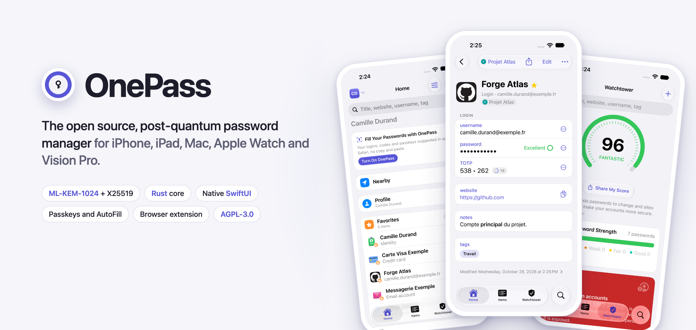
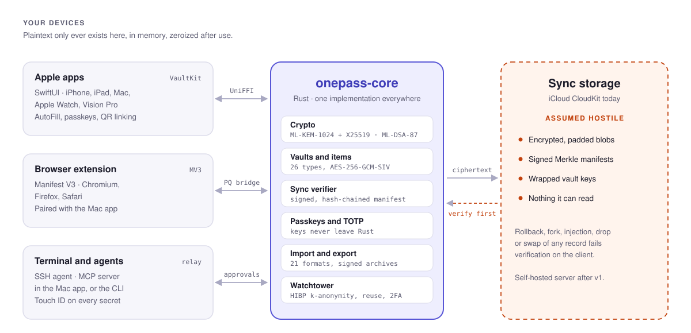
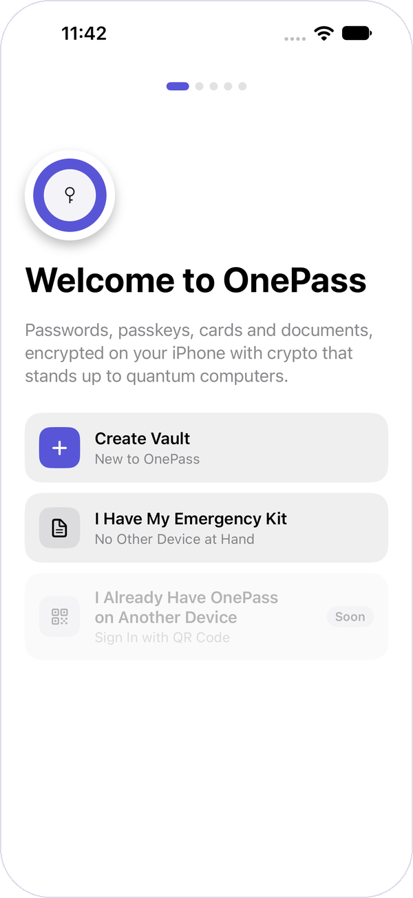
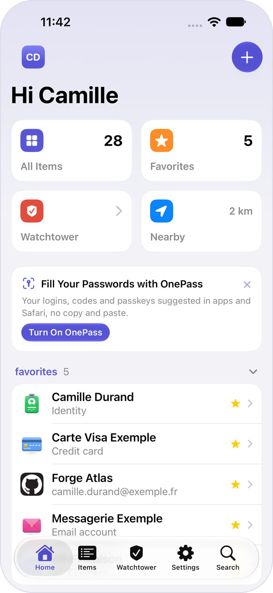
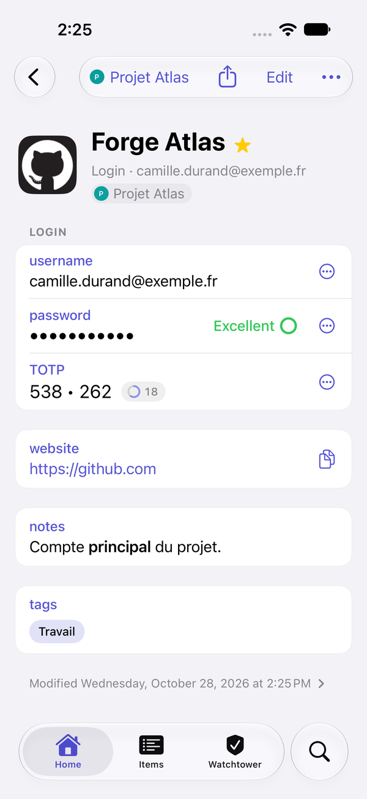
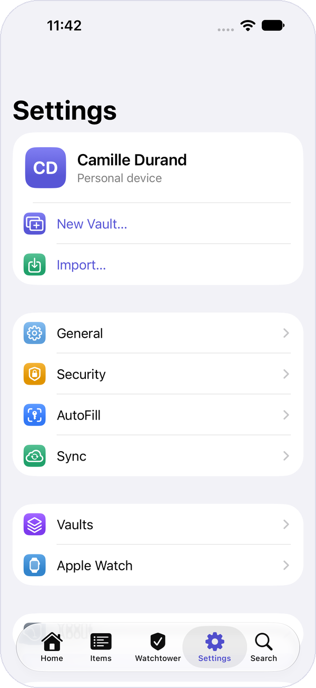
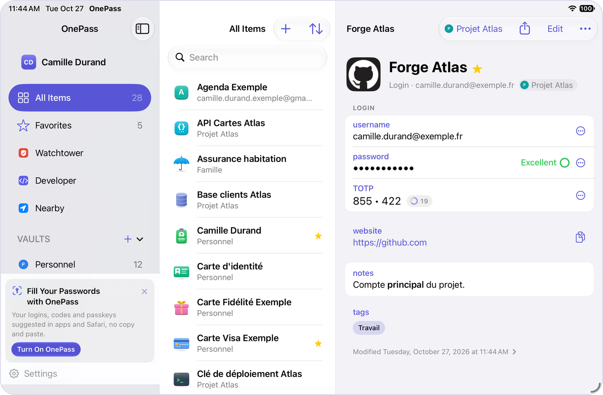
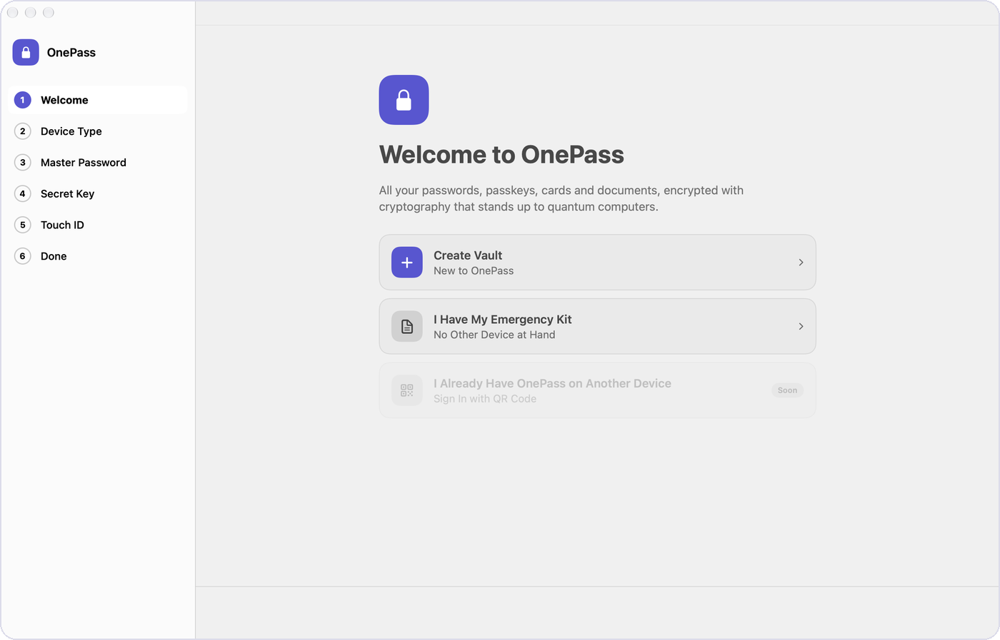
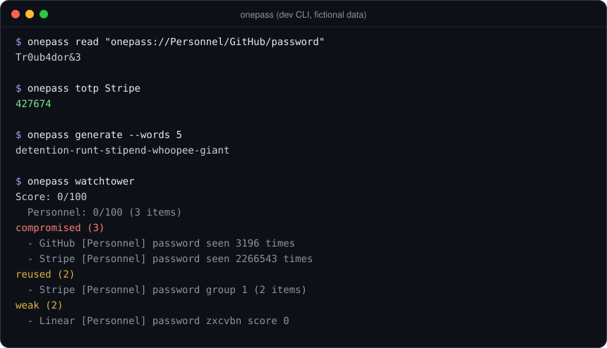
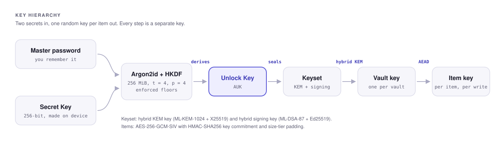

<div align="center">

<picture>
  <source media="(prefers-color-scheme: dark)" srcset="docs/assets/readme/hero-dark.png">
  
</picture>

<br>

[](https://github.com/soma-intelligence/onepass/actions/workflows/core.yml)
[](https://github.com/soma-intelligence/onepass/actions/workflows/extension.yml)
[](https://github.com/soma-intelligence/onepass/releases)
[](LICENSE)
<br>


**[Features](#features)** · **[Security](#security-model)** · **[Screenshots](#a-look-around)** · **[Getting started](#getting-started)** · **[Roadmap](#roadmap)** · **[Contributing](#contributing)**

</div>

> [!WARNING]
> OnePass is **pre-release software (v0.2.x)**. It has not had an external security audit yet (planned for milestone 8). The dev CLI and the dev native messaging host keep secrets in a form meant for development only. Do not store real secrets in OnePass until the first audited release.

## Why OnePass

<table>
<tr>
<td width="33%" valign="top">

**Post-quantum from day one**<br>
Vault keys are wrapped with hybrid ML-KEM-1024 + X25519. Manifests and backups are signed with hybrid ML-DSA-87 + Ed25519. Your account identity is an SLH-DSA key. Data harvested today stays safe against tomorrow's quantum computers.

</td>
<td width="33%" valign="top">

**The server is the adversary**<br>
Every vault carries a signed, hash-chained manifest with a Merkle root. A broken or malicious sync backend cannot roll back, fork, inject, drop or swap items without the client noticing. Each attack class from the 2026 ETH Zurich / USI study of cloud password managers is a test here.

</td>
<td width="33%" valign="top">

**Two secrets, not one**<br>
Your key comes from your master password **and** a 256-bit Secret Key generated on your device. A stolen copy of the sync data is useless without both.

</td>
</tr>
<tr>
<td valign="top">

**Native everywhere**<br>
One SwiftUI app target for iOS, iPadOS, macOS (native, not Catalyst) and visionOS, plus a standalone Apple Watch app, widgets, Controls and Shortcuts.

</td>
<td valign="top">

**At home in a terminal**<br>
A CLI, an SSH agent with per-signature approval, and an MCP server so AI agents can *use* a credential without ever *seeing* it.

</td>
<td valign="top">

**Reviewable and tested**<br>
Fuzzing, NIST ACVP vectors, differential tests between two crypto libraries, ProVerif models, and a seeded autofill lab that measures fill rate and leaks.

</td>
</tr>
</table>

## How it fits together

<picture>
  <source media="(prefers-color-scheme: dark)" srcset="docs/assets/readme/architecture-dark.svg">
  
</picture>

One Rust core holds every piece of crypto and vault logic. The Apple apps reach it through UniFFI, the browser extension through an end-to-end encrypted native messaging channel, and the terminal tools through `onepass-guard`, which asks for your approval and keeps a signed audit log. Sync storage only ever sees padded ciphertext, and everything it returns is verified before use.

## A look around

<table>
<tr>
<td align="center" width="25%"><picture><source media="(prefers-color-scheme: dark)" srcset="docs/assets/readme/iphone-welcome-dark.png"></picture><br><sub>Welcome</sub></td>
<td align="center" width="25%"><picture><source media="(prefers-color-scheme: dark)" srcset="docs/assets/readme/iphone-home-dark.png"></picture><br><sub>Home</sub></td>
<td align="center" width="25%"><picture><source media="(prefers-color-scheme: dark)" srcset="docs/assets/readme/iphone-detail-dark.png"></picture><br><sub>Item with TOTP</sub></td>
<td align="center" width="25%"><picture><source media="(prefers-color-scheme: dark)" srcset="docs/assets/readme/iphone-settings-dark.png"></picture><br><sub>Settings</sub></td>
</tr>
</table>

<table>
<tr>
<td align="center" width="50%"><picture><source media="(prefers-color-scheme: dark)" srcset="docs/assets/readme/ipad-dark.png"></picture><br><sub>iPad, three columns</sub></td>
<td align="center" width="50%"><picture><source media="(prefers-color-scheme: dark)" srcset="docs/assets/readme/mac-dark.png"></picture><br><sub>Mac, native SwiftUI (not Catalyst)</sub></td>
</tr>
</table>

<p align="center"><sub>All data in these screenshots is fictional demo data.</sub></p>

## Features

<details open>
<summary><b>Vault and items</b></summary>

- 26 item types: logins, passwords, secure notes, credit cards, bank accounts, crypto wallets, identities, passports, driver licenses, SSH keys, API credentials, servers, databases, routers, software licenses, documents and more. Logins also hold passkeys and TOTP secrets.
- Multiple vaults, fast search, favorites, TOTP codes, `onepass://vault/item/field` secret references.
- Password and passphrase generator (EFF word lists).
- Auto-lock, unlock with Face ID, Touch ID or Apple Watch on Mac. The master password is required again after a reboot or after 14 days.
- Emergency Kit PDF with a QR code, generated on device.
- Personal and shared device modes.

</details>

<details>
<summary><b>Sync</b></summary>

- End-to-end encrypted sync over **CloudKit**, inside your private iCloud database. Apple's own encryption is a bonus, not a dependency: the threat model assumes it fails.
- Self-hosted server (Rust, Postgres + S3) planned after v1.

</details>

<details>
<summary><b>AutoFill and passkeys</b></summary>

- System AutoFill provider on iPhone, iPad and Mac: QuickType suggestions, one-time codes in verification fields.
- **Passkeys** created and used inside the Rust core. The private key never reaches Swift.
- Save new passwords and suggest strong ones (iOS 26.2+).

</details>

<details>
<summary><b>Browser extension</b></summary>

- Manifest V3, TypeScript, no framework.
- Builds for Chromium, Firefox and Safari. Talks to the app over native messaging, through an end-to-end encrypted, post-quantum channel paired with a 6-digit code you compare on both screens.
- HTTPS origins only. Inline fill menu, save prompts, never-save list.

</details>

<details>
<summary><b>Watchtower</b></summary>

- Weak, reused and old passwords. Sites that support 2FA or passkeys but where you have not turned them on. Breached sites.
- Leaked password check through Have I Been Pwned **k-anonymity** (5-character hash prefix, padded responses). Offline modes available.

</details>

<details>
<summary><b>Import and export (21 formats)</b></summary>

| Source | Formats |
|---|---|
| 1Password | 1PUX, CSV |
| Bitwarden | JSON, CSV |
| Chrome, Safari, Firefox | CSV |
| LastPass | CSV |
| Dashlane | CSV, ZIP |
| Proton Pass | CSV |
| NordPass, Keeper, RoboForm | CSV |
| Enpass | JSON |
| KeePass 2 | XML |
| FIDO Credential Exchange | CXF |
| Other | `otpauth://` URIs, Wi-Fi QR codes, OnePass archive, OnePass CSV |

Export to a signed, encrypted `.onepass` archive (passphrase or account recipient). Plaintext CSV export exists but needs an explicit `--plaintext` flag.

</details>

<details>
<summary><b>Apple Watch, Vision Pro and widgets</b></summary>

- Standalone, read-only Watch app with TOTP rings, complications and Smart Stack. At most 50 items, and never login passwords, CVVs, PINs or notes.
- iOS widgets ("Codes", "Favorites"), Controls (generate, search, lock), App Intents and Shortcuts.
- visionOS layout from the same app target.

</details>

<details>
<summary><b>Developer tools</b></summary>

- **`onepass mcp`**: an MCP server (stdio JSON-RPC) with scoped tools (`metadata`, `use`, `write`, `totp`, `reveal`). Every secret request needs your approval in the terminal. Commands run with secrets injected and masked in output. Signed policy and a hash-chained, signed audit log.
- **`onepass ssh-agent`**: Ed25519, ECDSA P-256/384/521 and RSA 3072/4096 keys. Approval for every signature. Agent forwarding refused by default.
- **Travel Mode**: remove vaults from a device before crossing a border, bring them back after.

</details>

<p align="center">
  
</p>

## Security model

The full whitepaper and threat model live in [`docs/security/README.md`](docs/security/README.md). The short version:

<picture>
  <source media="(prefers-color-scheme: dark)" srcset="docs/assets/readme/keys-dark.svg">
  
</picture>

```
argon2_out = Argon2id(password_nfc, salt, m = 256 MiB, t = 4, p = 4)
AUK        = HKDF-SHA256(salt, argon2_out || secret_key, "onepass/auk/v1")
```
The Argon2id parameters above are enforced floors. The Secret Key is 256 bits, shown as 53 base32 characters with a Luhn mod 32 check character.

### Primitives

| Purpose | Algorithm |
|---|---|
| Password hashing | Argon2id v1.3 |
| Key derivation | HKDF-SHA256 |
| Blob encryption | AES-256-GCM-SIV + HMAC-SHA256 key commitment, size-tier padding |
| Vault key wrapping | ML-KEM-1024 + X25519 hybrid KEM |
| Manifests, backups, MCP policy | ML-DSA-87 + Ed25519 hybrid signature (both must verify) |
| Account root identity | SLH-DSA-SHA2-256s (FIPS 205) |
| Biometric unlock | Secure Enclave P-256 key, ECIES (X9.63, SHA-256, AES-GCM) |
| Passkeys | ECDSA P-256 (ES256) |
| Extension channel | ML-KEM-1024 + X25519, AES-256-GCM per direction, SAS pairing |

Crypto comes from `aws-lc-rs`, `argon2` and `slh-dsa` in Rust, and from WebCrypto plus `@noble/post-quantum` and `@noble/curves` in the extension.

### Threat model in brief
- **In scope:** a malicious or compromised storage backend (CloudKit, a future server, the network, a stolen disk) that modifies, replays, deletes, reorders or injects records. Hostile web pages and compromised renderers. Untrusted AI agents talking to the MCP server.
- **Out of scope:** a device compromised at OS level (root, jailbreak). An attacker who reads process memory (secrets are zeroized, `mlock` is not implemented yet). Traffic analysis beyond size-tier padding.
- **Known gaps** are listed honestly in the security doc and in the design specs.

### How it is tested

| | |
|---|---|
| **Known answers** | NIST ACVP vectors for ML-KEM-1024, ML-DSA-87 and SLH-DSA |
| **Differential** | `aws-lc-rs` against `libcrux`, property tests on the AEAD |
| **Fuzzing** | 19 `cargo-fuzz` targets, run in CI on every push |
| **Hostile server** | a malicious store test suite that replays every known server-side attack |
| **Formal models** | ProVerif (`formal/`) for account creation and unlock, vault manifests, the Emergency Kit and the extension bridge, including runs where one half of each hybrid KEM is broken. `make formal`, [results](docs/security/formal/results.md) |
| **Autofill lab** | hundreds of seeded, fictional websites served locally (`extension/lab/`). First 200-site run: 63.8% fill rate and **0 leaks** ([report](docs/lab/2026-10-26-autofill-lab-run.md)) |

Found a vulnerability? Please do not open a public issue. See [Reporting a vulnerability](#reporting-a-vulnerability).

## Getting started

### Requirements

| Component | Needs |
|---|---|
| Rust core and CLI | Rust 1.99.1 (pinned in `core/rust-toolchain.toml`), nightly + `cargo-fuzz` for fuzzing |
| Apple apps | macOS with Xcode 27, XcodeGen (`brew install xcodegen`), watchOS 27 and visionOS 27 simulator runtimes |
| Extension | Node 22, plus `cargo`, `openssl` and Playwright Chromium for end-to-end tests |

Apps target iOS 26, iPadOS 26, macOS 26, watchOS 26 and visionOS 26 or later.

### Clone
```bash
git clone https://github.com/soma-intelligence/onepass.git
```

### Core and CLI
```bash
make -C core check
```
Runs `cargo fmt --check`, `clippy -D warnings`, the full test suite and `cargo deny`.

Try the CLI (dev mode, not for real secrets):
```bash
cargo run --manifest-path core/Cargo.toml -p onepass-cli -- --help
```
```bash
onepass account create
onepass item create login --title "Example" --field username=alice --field password=hunter2
onepass item get "Example" --reveal
onepass read "onepass://Personnel/Example/password"
onepass totp "Example"
onepass generate --words 5
onepass import export.1pux --dry-run
onepass watchtower
onepass backup create --out vault.onepass --passphrase
```

### Apple apps
Add the Rust targets once:
```bash
rustup target add aarch64-apple-ios aarch64-apple-ios-sim aarch64-apple-darwin aarch64-apple-watchos aarch64-apple-watchos-sim aarch64-apple-visionos aarch64-apple-visionos-sim
```
Build the Rust XCFramework and Swift bindings, then the apps:
```bash
make -C apple core
```
```bash
make -C apple build-mac
```
Other targets: `build-ios`, `build-watch`, `build-vision`, `test`, `uitest`, `uitest-autofill`, `screenshots`. The Xcode project is generated from `apple/project.yml` with `make -C apple project`. More in [`apple/README.md`](apple/README.md).

CloudKit sync is only compiled into the signed `Release-CloudKit` configuration, which needs your own Apple Developer team and iCloud container.

### Browser extension
```bash
cd extension && npm ci && npm run check
```
`npm run check` typechecks, runs the unit tests and builds every browser. End-to-end tests run with `npm run e2e`, and the autofill lab with `npm run lab:smoke`. More in [`extension/README.md`](extension/README.md).

## Repository layout

```
onepass/
├── core/                      Rust workspace
│   ├── onepass-core           crypto, accounts, vaults, items, sync, TOTP, import/export,
│   │                          Watchtower, passkeys
│   ├── onepass-cli            the `onepass` command line
│   ├── onepass-ffi            UniFFI bindings for Swift
│   ├── onepass-guard          approvals, signed config, chained audit log
│   ├── onepass-mcp            MCP server
│   ├── onepass-ssh-agent      SSH agent
│   ├── onepass-bridge         extension ↔ app protocol (no I/O)
│   ├── onepass-native-host    native messaging host (dev)
│   ├── onepass-peer           checks which local process is calling (code signature, hardened runtime)
│   └── fuzz/                  cargo-fuzz targets
├── apple/                     SwiftUI apps (XcodeGen)
│   ├── VaultKit               Swift package over the Rust core
│   ├── DesignKit              colors, icons, shared components
│   ├── CompanionKit           widgets and iPhone ↔ Watch link
│   ├── App/                   iOS, iPadOS, macOS and visionOS app
│   ├── AutoFill/              system AutoFill provider
│   └── Watch/, Widgets/, …    Apple Watch app, widgets, Controls
├── extension/                 MV3 browser extension (TypeScript, esbuild)
│   ├── src/                   background, content scripts, bridge, UI
│   ├── e2e/                   Playwright tests
│   └── lab/                   seeded autofill lab
├── formal/                    ProVerif models of the protocols
└── docs/
    ├── security/              whitepaper and threat model
    ├── specs/                 design specs per milestone
    └── lab/                   autofill lab reports
```

## Roadmap

| | Milestone | Scope | Status |
|:-:|---|---|---|
| ✅ | M1 | Rust core, crypto, 26 item types, dev CLI | Done |
| ✅ | M2 | Apple apps, unlock, CloudKit sync | Done (real iCloud verification pending) |
| ✅ | M3 | System AutoFill, passkeys, one-time codes | Done |
| ✅ | M4 | Browser extension, encrypted native messaging | Done (Safari extension in the Mac app, Debug builds only until the app serves the bridge) |
| ✅ | M5 | Watchtower, import, export, signed backups | Done |
| ✅ | M6 | Apple Watch, Vision Pro, widgets, Shortcuts | Done |
| ✅ | M7 | MCP server, SSH agent, Travel Mode | Done |
| ✅ | M2b | QR device linking, signed device list, revocation, public computer mode | Done (two-device iCloud verification pending) |
| ⬜ | M8 | External audit, public launch | Planned |
| ⬜ | Later | Self-hosted server, sharing and organizations, web app (WASM), recovery codes | Planned |

Each milestone has its design spec in [`docs/specs/`](docs/specs/).

## Contributing

Contributions are welcome, especially reviews of the crypto and the threat model.

1. Read the [security doc](docs/security/README.md) and the spec for the area you want to touch.
2. Open an issue to discuss anything larger than a small fix.
3. Keep `make -C core check`, `make -C apple test` and `npm run check` green. CI runs them on macOS and Linux.
4. New crypto or storage code comes with tests, and with a fuzz target when it parses untrusted input.

Before your first pull request is merged, you sign the [contributor license agreement](CLA.md) once, by replying to the bot. More in [CONTRIBUTING.md](CONTRIBUTING.md).

## Reporting a vulnerability

Please report security issues privately through [GitHub Security Advisories](https://github.com/soma-intelligence/onepass/security/advisories/new) or to security@somalabs.me, never in a public issue. We acknowledge reports within 72 hours. The full policy, including safe harbor for good faith research, is in [SECURITY.md](SECURITY.md).

## License

OnePass is licensed under the [GNU Affero General Public License v3.0 or later](LICENSE). You can use, study, change and share it. If you distribute a modified version, or run one as a network service, you must publish its source under the same license.

For a commercial license without the AGPL terms, write to security@somalabs.me with "License" in the subject. Third-party word lists keep their own licenses, listed in [`core/onepass-core/data/LICENSES.md`](core/onepass-core/data/LICENSES.md).

---

<div align="center">
<sub>Built by <a href="https://somalabs.me">Soma Labs</a>.</sub>
</div>
